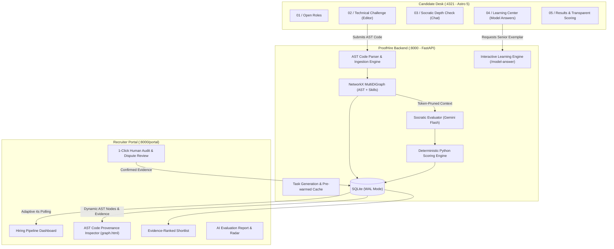

# ProofHire ⚡
### Evidence-Based Technical Hiring Platform
> *"The signal is in the explanation."*  
> Replacing LeetCode memorization and AI-generated resume inflation with practical engineering challenges, AST-grounded Socratic depth interviews, and auditable code provenance graphs.

---

## 📌 Problem & Motivation

Modern software hiring is broken by generative AI on both sides:
1. **80% of candidates use LLMs to ace LeetCode & HackerRank screens** without understanding the underlying code, concurrency, or architectural trade-offs.
2. **Resumes are hyper-inflated** with AI-generated buzzwords, making traditional keyword screening completely ineffective.
3. **Current AI interviewers are opaque black boxes** that hallucinate ratings, offer zero candidate feedback, and lack auditability.

**ProofHire solves this.** Passing unit tests proves code runs; **ProofHire proves the human wrote it and understands why it works.** Candidates solve real systems problems in an in-browser sandbox, followed by an adaptive, multi-turn Socratic AI cross-examination grounded in their exact AST (Abstract Syntax Tree) code nodes.

---

## 🏛️ System Architecture



---

## ✨ Key Features & Capabilities

### 1. Recruiter AST Code Provenance Knowledge Graph (`/portal/graph.html`)
* **Why it matters:** Generative AI allows anyone to copy-paste working solutions. ProofHire parses the repository into a semantic AST network (Files, Classes, Functions, and Claimed Skills).
* **Color-Coded Verification Signals:**
  * 🟢 **Verified Author (Green):** Candidate defended their code in Socratic Depth Check with deep technical grasp (e.g. concurrency handling, monotonic clock drift).
  * 🔴 **Flagged / Evasive / AI Suspected (Red):** Candidate was unable to explain their own functions or trade-offs (e.g. copy-pasted code).
  * 🔵 **Code Files (Blue):** Source containers (`limiter.py`).
  * 🟣 **AST Classes & Structs (Purple):** Architecture definitions (`TokenBucketLimiter`, `Event`).
  * 🟡 **Claimed Skills (Amber):** Skills verified against actual implementation lines.
* **Click-to-Inspect Provenance Drawer:** Clicking any node reveals the exact source lines, verification status, and verbatim interview quote.
* **Dual-Mode Switcher:** Toggle between **🔬 Candidate Code Provenance** and **🌐 Talent Pool Macro Topology**.

### 2. Socratic AST-Grounded Depth Check
* After submitting code, candidates enter an interactive technical conversation grounded in their code.
* ProofHire cites specific lines and functions (`limiter.py:24` `allow`).
* **Instant Evasion Detection:** If a candidate types `"dk"`, `"idk"`, or gives superficial non-answers (`"it is standard best practice"`), ProofHire deterministically scores `0/5`, flags `evasive`, and deducts marks mathematically without hallucinating praise.
* **Verbatim Substring Validation:** ProofHire extracts exact candidate quotes into an immutable evidence ledger.

### 3. Interactive Learning Center & Senior Engineering Model Answers
* Accessible at all times via the top tab on the Candidate Desk (`#depth`):
  * `[ 💬 Active Socratic Interview ]`
  * `[ 📚 Question History & Model Answers (Learning Center) ]`
* **"💡 View Model Answer & Learn":** Candidates can inspect:
  * **Ideal Senior/Staff Engineering Responses**
  * **Core Computer Science Principles** (e.g. Monotonic time vs wall-clock, non-blocking coroutines, lock contention)
  * **Common Interview Pitfalls to Avoid**
  * **Principal Engineer Pro-Tips**

### 4. Complete Candidate Transparency & Dispute Rights
* Candidates can review the **Depth Check Audit Ledger** to see where marks were deducted.
* Candidates can click **🚩 Report Evaluation Issue** to contest grading, immediately routing the turn to the hiring manager for human audit.

### 5. Multi-Agent Cohort Simulation Suite (`simulate_cohort.py`)
* End-to-end multi-agent simulation testing 10 distinct personas across the platform:
  * Technical test-takers: Senior Systems Architect (Shortlisted), Junior Backend Intern (Gaps Flagged), Frontend Architect, and Copy-paster (Flagged Evasive / Rejected).
  * Normal users verifying UI readability, font sizing, and draft persistence.
  * Recruiter auditing pipeline metrics, filtering roles, and confirming evidence.

---

## 🚀 Getting Started & Running Locally

### Prerequisites
* **Python 3.10+** (Python 3.11, 3.12, or 3.14)
* **Node.js 18+** & **npm**

---

### Quick Directory & Terminal Cheatsheet

| Process | Working Directory | Command to Start | Live URL |
| :--- | :--- | :--- | :--- |
| **Terminal 1: Backend** | `proofHire/` (Root) | `python -m uvicorn backend.main:app --host 0.0.0.0 --port 8000 --reload` | [`http://localhost:8000`](http://localhost:8000) |
| **Terminal 2: Frontend** | `proofHire/frontend/` | `npm run dev -- --host 0.0.0.0 --port 4321` | [`http://localhost:4321`](http://localhost:4321) |

---

### Step 1: Clone the Repository & Enter Directory
Open your terminal (PowerShell, Bash, or Command Prompt):
```bash
# Clone the repository
git clone https://github.com/Tech1824/proofHire.git

# Enter the project root directory
cd proofHire
```
> 📍 **Current Working Directory:** `.../proofHire/`

---

### Step 2: Configure Environment Variables (`.env`)
ProofHire includes a pre-configured template file named `.env.example` in the `proofHire/` root directory.

1. **Create your `.env` file** (must be named exactly `.env` with a leading dot, located in `proofHire/`):
   ```bash
   # On Windows (cmd):
   copy .env.example .env

   # On Windows (PowerShell) or macOS / Linux:
   cp .env.example .env
   ```

2. **Open `.env` in any text editor and configure your key:**
   ```env
   # 1. Google Gemini API Key (for live AI generation)
   # Get a free key at: https://aistudio.google.com/app/apikey
   GEMINI_API_KEY=your_actual_gemini_api_key_here

   # 2. Platform Settings
   PUBLIC_USE_MOCKS=false
   ```
   > 💡 **Offline Mode / No API Key?**  
   > If you do not have a Gemini API key or leave `GEMINI_API_KEY` blank, **ProofHire automatically runs in offline mode using pre-warmed, deterministic senior engineering models with zero downtime!**

---

### Step 3: Run the Python Backend (Terminal 1)
In your first terminal, make sure you are in the **`proofHire/` root directory**:

```bash
# 1. Install backend dependencies (run from proofHire/)
pip install -r requirements.txt

# 2. Seed database with real-world demo roles and candidates (Dev Patel, Arjun, Asha, Ravi, Liam)
python seed_db.py

# 3. Start the FastAPI backend server with auto-reload
python -m uvicorn backend.main:app --host 0.0.0.0 --port 8000 --reload
```
* **Expected Output:**
  ```text
  INFO:     Uvicorn running on http://0.0.0.0:8000 (Press CTRL+C to quit)
  INFO:     Started reloader process using WatchFiles
  ```
* The backend is now live at **`http://localhost:8000`**.  
* Interactive Swagger API documentation is available at **`http://localhost:8000/docs`**.

---

### Step 4: Run the Astro Frontend (Terminal 2)
Open a **new terminal tab or window**:

```bash
# 1. Navigate to the frontend directory
cd proofHire/frontend

# (Or if your terminal is already inside proofHire, simply run: cd frontend)

# 2. Install Node dependencies (run from proofHire/frontend/)
npm install

# 3. Start the Astro development server
npm run dev -- --host 0.0.0.0 --port 4321
```
* **Expected Output:**
  ```text
  astro ready in ~250 ms
  ┃ Local    http://localhost:4321/
  ```
* The candidate desk is now live at **`http://localhost:4321`**.

---

### 🛠️ Common Troubleshooting

* **`ModuleNotFoundError: No module named 'backend'`**:  
  Make sure you execute the uvicorn command from the **`proofHire/` root directory**, NOT from inside `backend/` or `frontend/`.
* **`python` vs `python3`**:  
  On macOS or Linux, replace `python` and `pip` with `python3` and `pip3` (e.g. `python3 seed_db.py`).
* **Port `8000` or `4321` already in use**:  
  Another background process is running on that port. Stop existing processes or run uvicorn on an alternative port:  
  `python -m uvicorn backend.main:app --host 0.0.0.0 --port 8001 --reload`

---

## 🖥️ Live Portal Endpoints

| Portal | URL | Description |
| :--- | :--- | :--- |
| **Candidate Desk** | [`http://localhost:4321`](http://localhost:4321) | Candidate assessment, live code editor, Socratic depth check, and Learning Center. |
| **Recruiter Dashboard** | [`http://localhost:8000/portal/dashboard.html`](http://localhost:8000/portal/dashboard.html) | Hiring pipeline dashboard, jobs requisition desk, and candidate audit ledger. |
| **AST Provenance Graph** | [`http://localhost:8000/portal/graph.html`](http://localhost:8000/portal/graph.html) | Interactive code AST provenance inspector with verified evidence quotes. |
| **Shortlist & Evidence** | [`http://localhost:8000/portal/shortlist.html`](http://localhost:8000/portal/shortlist.html) | Evidence-ranked candidates with verified quotes and 1-click human approval. |
| **Candidate Comparison** | [`http://localhost:8000/portal/compare.html`](http://localhost:8000/portal/compare.html) | Side-by-side dimensional skill comparison (Arjun vs Ravi). |
| **Backend API Docs** | [`http://localhost:8000/docs`](http://localhost:8000/docs) | Interactive Swagger UI for all REST endpoints. |

---

## 🧪 Quick Test & Demo Scenarios

### Scenario A: Test AST Provenance Graph on Recruiter Side
1. Open `http://localhost:8000/portal/graph.html`.
2. Select **Dev Patel** or **Arjun Mehta** from the Candidate Dossier dropdown.
3. Click on the green `allow` or `ingest_event` function node.
4. **Result:** The Provenance Inspector opens showing the candidate's exact submitted code, verified authorship badge, and the Socratic depth interview quote.

### Scenario B: Test Instant Evasion Detection (`dk`)
1. Go to `http://localhost:4321#depth`.
2. Start a session or click **⚡ Use Demo Submission (Arjun Mehta)**.
3. Type `"dk"` or `"idk"` in the response field and press **Enter**.
4. **Result:** ProofHire immediately awards `0/5`, flags `evasive`, logs reasoning, and adjusts the running score without hallucinating praise.

### Scenario C: Interactive Learning Center & Model Answers
1. Go to `http://localhost:4321#depth`.
2. Click the top tab **📚 Question History & Model Answers (Learning Center)**.
3. Click **💡 View Model Answer & Learn** on any technical architecture question.
4. **Result:** The card dynamically expands showing the senior engineering exemplar, core CS principles, and common interview pitfalls.

---

## 📂 Project Directory Structure

```text
proofHire/
├── backend/                  # FastAPI REST API services
│   ├── routes/               # API route handlers (jobs, depth, candidates, company, etc.)
│   ├── fakes.py              # Zero-latency deterministic fixture mocks
│   ├── schemas.py            # Pydantic schemas with AST graph node metadata
│   └── main.py               # Application entrypoint & CORS middleware
├── ai/                       # Core AI & Knowledge Graph engine
│   ├── graph.py              # NetworkX AST Knowledge Graph builder
│   ├── evaluator.py          # Socratic depth interviewer & deterministic scorer
│   ├── judge.py              # Turn-level Socratic evaluator with anti-hallucination guards
│   └── api.py                # Graph queries, token-pruned context, and model answers
├── db/                       # Database models & persistence
│   ├── models.py             # SQLModel tables (Job, Candidate, QaTurn, Profile, etc.)
│   └── crud.py               # Concurrency-safe SQLite engine with WAL mode
├── frontend/                 # Candidate Portal (Astro 5 Island Architecture)
│   ├── src/
│   │   ├── pages/            # Astro static entry routes
│   │   ├── scripts/app.js    # Client-side router, Socratic chat, Learning Center
│   │   └── lib/api.js        # Resilient API communication layer
│   └── package.json
├── proofhire-company-portal/ # Recruiter Talent Portal (ATS & Audit Ledger)
│   ├── dashboard.html        # Company pipeline overview
│   ├── graph.html            # Candidate AST Code Provenance & Semantic Network
│   ├── shortlist.html        # Evidence-ranked candidates
│   ├── ai-report.html        # In-depth candidate radar & dispute review
│   ├── compare.html          # Head-to-head candidate evaluation
│   └── js/portal.js          # Live 4s polling sync engine
├── simulate_cohort.py        # 10-persona multi-agent simulation suite
└── seed_db.py                # Database seeding script for demo data
```

---

## 🛡️ License

MIT License. Designed and built with ❤️ for evidence-first software engineering.
